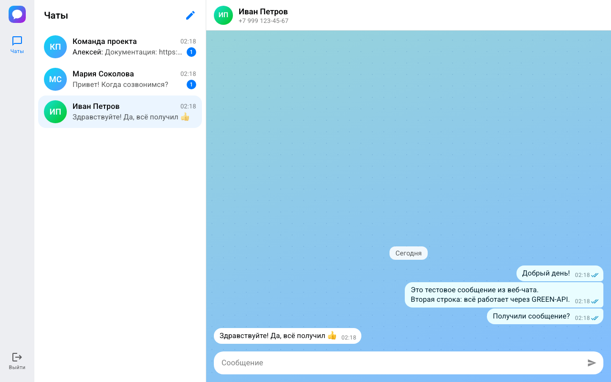
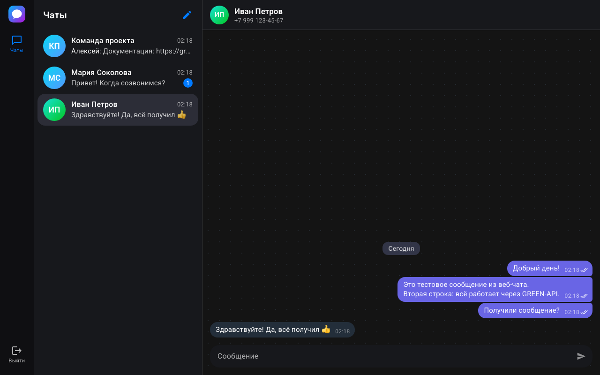
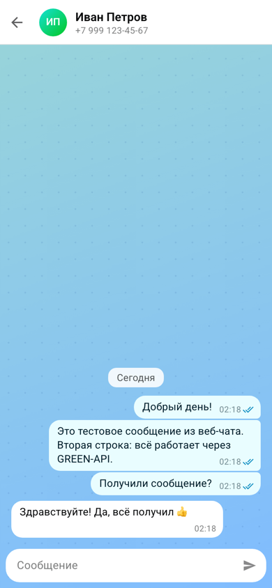

# MAX Web Chat · GREEN-API

Тестовое задание на должность «Фронтенд-разработчик React»: простой веб-интерфейс для отправки и получения
текстовых сообщений в мессенджере [MAX](https://max.ru) через сервис [GREEN-API](https://green-api.com/max).
Внешний вид повторяет веб-версию MAX ([web.max.ru](https://web.max.ru)): цвета, шрифт, пузыри сообщений
и раскладка взяты из её дизайн-токенов.



## Что умеет

- **Вход** по `idInstance` и `apiTokenInstance` из личного кабинета GREEN-API. Данные проверяются запросом
  [GetStateInstance](https://green-api.com/v3/docs/api/account/GetStateInstance/).
- **Новый чат по номеру телефона.** Номер переводится в `chatId` пользователя MAX методом
  [CheckAccount](https://green-api.com/v3/docs/api/service/CheckAccount/).
- **Отправка** текстовых сообщений методом [SendMessage](https://green-api.com/v3/docs/api/sending/SendMessage/).
- **Получение** сообщений по технологии [HTTP API](https://green-api.com/v3/docs/api/receiving/technology-http-api/):
  [ReceiveNotification](https://green-api.com/v3/docs/api/receiving/technology-http-api/ReceiveNotification/)
  (long polling) → обработка →
  [DeleteNotification](https://green-api.com/v3/docs/api/receiving/technology-http-api/DeleteNotification/).
- Статусы сообщений (отправляется / отправлено / доставлено / прочитано / ошибка), счётчики непрочитанных,
  чаты, которые начал собеседник, сообщения из групп и с других устройств аккаунта.
- Предупреждения, если инстанс не авторизован, в его настройках выключены входящие уведомления или указан
  `webhookUrl`, пропала связь с сервером, исчерпан лимит тарифа. Если ключ доступа сменили в личном кабинете,
  можно войти заново, не теряя историю.
- Тёмная тема по системной настройке и вёрстка для телефона.
- Вход и история переписки сохраняются в браузере, кнопка «Выйти» их удаляет.

| Тёмная тема | Телефон |
| --- | --- |
|  |  |

## Запуск

Нужен Node.js 22.22 или новее (версия указана в `.nvmrc`).

```bash
npm ci
npm run dev
```

Приложение откроется на http://localhost:5173.

## Как проверить

1. В [личном кабинете GREEN-API](https://console.green-api.com) создайте инстанс MAX (тариф «Разработчик»
   бесплатный) и авторизуйте его, отсканировав QR-код в приложении MAX.
2. Убедитесь, что в настройках инстанса включены уведомления о входящих сообщениях, а `webhookUrl` пуст:
   иначе HTTP API не отдаёт уведомления. Если это не так, приложение покажет предупреждение.
3. Введите `idInstance` и `apiTokenInstance`. Адрес API определяется по первым четырём цифрам `idInstance`
   (`https://3100.api.green-api.com`); при необходимости его можно указать вручную в разделе «Дополнительно».
4. Нажмите ✎ («Новый чат»), введите номер телефона получателя и отправьте сообщение.
5. Ответьте с телефона получателя в MAX — ответ появится в чате.

## Как устроено

```
src/
├── api/greenApi.ts            клиент HTTP API: запросы, таймауты, понятные тексты ошибок
├── lib/notifications.ts       разбор входящих уведомлений в события приложения
├── state/notificationLoop.ts  цикл ReceiveNotification → обработка → DeleteNotification с повторами при сбоях
├── state/chatReducer.ts       состояние чатов: сообщения, статусы, непрочитанные (useReducer)
├── state/storage.ts           сохранение в localStorage
└── components/                интерфейс: вход, список чатов, переписка, диалог нового чата
```

Сообщения адресуются по числовому `chatId`, а не по `79991234567@c.us`: ответы из MAX приходят с `chatId`,
а на тарифе «Разработчик» один собеседник в двух форматах засчитывается как два чата из трёх доступных.

Приложение работает только в браузере: GREEN-API разрешает запросы с любого источника (CORS), поэтому
серверная часть не нужна.

## Команды

| Команда | Что делает |
| --- | --- |
| `npm run dev` | сервер разработки |
| `npm test` | тесты (Vitest + Testing Library), включая сценарий из задания на имитации GREEN-API |
| `npm run lint` | проверка кода (oxlint) |
| `npm run build` | проверка типов и сборка в `dist/` |

Сборка — статические файлы с относительными путями, их можно разместить на любом хостинге,
например GitHub Pages.

## Ограничения

- Только текстовые сообщения, как требует задание; фото, стикеры и другие типы не отображаются.
- История хранится в браузере. GREEN-API отдаёт каждое уведомление один раз, поэтому приложение лучше держать
  открытым в одной вкладке.
- Поиск собеседника по номеру работает для номеров России (+7) и Беларуси (+375) — это ограничение
  метода CheckAccount.
- Тариф «Разработчик»: не больше 3 чатов в месяц и 100 проверок номеров.
